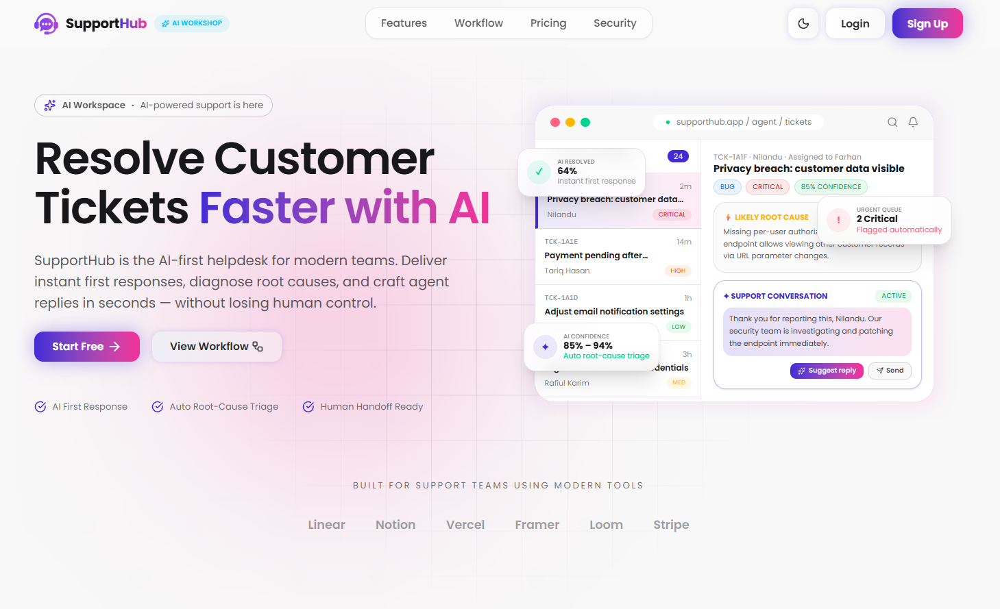

# SupportHub — AI-Assisted SaaS Helpdesk Frontend

<p align="center">
  <strong>Modern Multi-Tenant Customer Support Workspace &amp; AI Triage Interface</strong><br />
  Built with React, React Router, Tailwind CSS v4, DaisyUI v5, TanStack Query, and Firebase Authentication.
</p>

<p align="center">
  
  
  
  
  
</p>

---

## Overview

**SupportHub Frontend** is the client web application for an AI-first multi-tenant SaaS customer support platform. It provides role-tailored dashboards, guided AI-assisted ticket submission, real-time customer–agent ticket conversations, one-click AI reply suggestions, workspace analytics, and Stripe subscription management across dark and light themes.

<p align="center">
  
</p>

---

## Key Features & User Workflows

### 1. Guided 4-Step AI Ticket Submission (Customer)
- **Step 1 — Describe:** Customers submit issue descriptions and optional context from the support portal.
- **Step 2 — AI Response:** Displays instant AI First Response with automated `Category`, `Priority`, `Risk Level`, `Confidence Score`, `Likely Root Cause`, `Recommended Actions`, and `Suggested Resolution Steps`.
- **Step 3 — Decide:** Customers can mark the issue as immediately resolved by AI or escalate to a human agent with the full AI diagnostic report attached.
- **Step 4 — Confirm:** Confirms ticket creation and provides direct access to the live conversation thread.

### 2. Real-Time Agent Workspace & One-Click Suggest Reply
- **AI Diagnostics Panel:** Agents view customer issue details alongside structured AI root-cause insights, severity metrics, and resolution steps.
- **Live Support Conversation:** Real-time message thread between customer and assigned agent with instant `Release` and `Resolve` controls.
- **Suggest Reply:** Agents can click **Suggest reply** on an empty input or rough draft to generate a polished, context-aware customer reply before sending.

### 3. Dedicated Customer & Agent AI Assistants
- Built-in AI chat workspaces (`/customer/ai-assistant` and `/agent/ai-assistant`) with searchable conversation history, quick prompt starters, and multi-turn troubleshooting.

### 4. Manager & Owner Governance Dashboards
- **Urgent Queue & Smart Assignment:** Flags `Critical` and `High` priority open tickets for managers and owners to assign or reassign to approved agents.
- **Staff Onboarding & Approvals:** Pending `Manager` and `Agent` join requests are reviewed and approved directly from team management views.
- **Live Analytics & Quotas:** Tracks AI vs. human resolution rates, weekly activity, and monthly plan usage (`Managers`, `Agents`, `Tickets`, and `AI Replies`).
- **Stripe Subscription & Billing:** Owners can upgrade across `Default ($0)`, `Starter ($19)`, `Growth ($49)`, `Scale ($99)`, and `Enterprise ($249)` plans and view completed Stripe payment history.

---

## Role-Based UI & Routing Architecture

Each role receives a dedicated dashboard shell (`DashboardLayout`), navigation menu, color-coded role badge, and route protection:

| Role | Badge Theme | Primary Routes |
| :--- | :--- | :--- |
| **Owner** | Orange (`Crown`) | `/owner/dashboard`, `/owner/tickets`, `/owner/team`, `/owner/subscription` |
| **Manager** | Pink (`ShieldCheck`) | `/manager/dashboard`, `/manager/tickets`, `/manager/agents`, `/manager/customers` |
| **Agent** | Cyan (`Headphones`) | `/agent/dashboard`, `/agent/tickets`, `/agent/my-tickets`, `/agent/ai-assistant` |
| **Customer** | Green (`UserRound`) | `/customer/dashboard`, `/customer/tickets`, `/customer/tickets/new`, `/customer/ai-assistant` |
| **Shared / Public** | Info (`Sparkles`) | `/`, `/login`, `/register`, `/legal` (`#terms`, `#privacy`), `/notifications`, `/profile` |

---

## Tech Stack & Project Structure

- **Framework, Bundler & Routing:** React, Vite (`@/` path aliases), React Router
- **Styling & Theming:** Tailwind CSS v4, DaisyUI v5 (custom `light` and `dark` themes with `#A770EF` primary and `#FDB99B` secondary brand palette + `Poppins` typography), `clsx` + `tailwind-merge` (`cn`)
- **Data Fetching & Caching:** TanStack Query (`useQuery`, `useMutation`, automated cache invalidation & polling for notifications)
- **Authentication & Media:** Firebase Authentication (Email/Password + Google Sign-In) & optional ImgBB profile avatar upload
- **Forms & UX:** React Hook Form, Lucide React, React Icons, React Scroll, SweetAlert2, React Toastify

```text
src/
├── assets/                      # Brand logo & static media
├── components/
│   ├── common/                  # Shared layout components (Navbar, Footer, ScrollToTop)
│   ├── features/
│   │   ├── home/                # Landing page sections (Hero, HeroWindow, Problem, Solution, Workflow, Pricing, Security, CTA)
│   │   └── tickets/             # 4-step AI ticket submission flow components
│   └── ui/                      # Reusable primitives (TextBadge, PromoBadge, GradientButton, GradientText, CardWithBlurBlob, GradientShadowWrapper)
├── config/
│   └── firebase.config.js       # Firebase client initialization
├── layouts/                     # RootLayout, AuthLayout & DashboardLayout (collapsible sidebar + role topbar)
├── lib/
│   ├── cn.js                    # Tailwind class merging utility
│   └── formatRelativeDate.js    # Relative timestamp formatter
├── pages/
│   ├── public/                  # Home & LegalPage (smooth-scrolling Terms & Privacy)
│   ├── auth/                    # Login, Register (with Terms & Privacy consent) & ForgotPassword
│   ├── shared/                  # Notifications Center & Profile Settings
│   ├── customer/                # Customer Dashboard, Tickets, 4-Step New Ticket & AI Assistant
│   ├── agent/                   # Agent Dashboard, Company/My Tickets, Live Conversation & AI Assistant
│   ├── manager/                 # Manager Overview, Ticket Assignment, Agent Approvals & Customers
│   ├── owner/                   # Owner Dashboard, Team & Roles, Stripe Subscription & Billing
│   └── system/                  # LoadingPage, ErrorPage & ErrorApp
├── providers/
│   └── AuthProvider.jsx         # Firebase auth state, JWT token & role resolution
├── routes/
│   ├── PrivateRoute.jsx         # Authenticated route guard
│   ├── RoleRoute.jsx            # Role-based access guard (owner, manager, agent, customer)
│   └── DashboardRedirect.jsx    # Smart role-based dashboard redirector
├── index.css                    # Tailwind v4 imports & custom DaisyUI light/dark theme tokens (#A770EF & #FDB99B)
└── main.jsx                     # App entry point, QueryClient, AuthProvider & centralized BrowserRouter
```

---

## Getting Started

### Prerequisites
- **Node.js** v18+
- **SupportHub Backend API** running locally or deployed
- **Firebase Web App** credentials
- **ImgBB API Key** (for optional profile image uploads)

### Installation

```bash
# 1. Clone the repository
git clone https://github.com/nknilandu/support-hub.git
cd supporthub-client

# 2. Install dependencies
npm install

# 3. Configure environment variables
cp .env.example .env
```

### Environment Variables (`.env`)

```env
# Backend API Base URL
VITE_API_URL=https://support-hub-server.vercel.app

# Firebase Client Configuration
VITE_FIREBASE_API_KEY=your_firebase_api_key
VITE_FIREBASE_AUTH_DOMAIN=your_project.firebaseapp.com
VITE_FIREBASE_PROJECT_ID=your_project_id
VITE_FIREBASE_STORAGE_BUCKET=your_project.appspot.com
VITE_FIREBASE_MESSAGING_SENDER_ID=your_messaging_sender_id
VITE_FIREBASE_APP_ID=your_firebase_app_id

# Optional Avatar Upload
VITE_IMGBB_API_KEY=your_imgbb_api_key
```

### Run the Application

```bash
# Start development server
npm run dev

# Build for production
npm run build
```

---

## Author

**Nilandu Kumar Das Vapon**
- GitHub: [@nknilandu](https://github.com/nknilandu)
- LinkedIn: [linkedin.com/in/nilandu](https://www.linkedin.com/in/nilandu)
- Facebook: [facebook.com/nknilandu](https://www.facebook.com/nknilandu)
- Email: nknilandu@gmail.com

---

## License

Copyright © 2026 Nilandu Kumar Das Vapon. All rights reserved.

This code is available for viewing and review only.
Reuse, modification, redistribution, and commercial use require
prior written permission. See [LICENSE](./LICENSE).